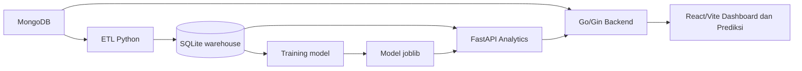

# HKBP — Dashboard Analitik Keuangan dan Prediksi Pelean Ibadah

Proyek Terintegrasi Data Analitik & Data Science — Kelompok 11  
Institut Teknologi Del | Semester Ganjil 2026/2027  
Dosen pengampu: Oppir Hutapea, M.Kom.

## 1. Deskripsi proyek

Sistem ini mengintegrasikan dashboard analitik keuangan dan kehadiran ibadah HKBP dengan modul machine learning untuk memprediksi total pelean (persembahan) pada sesi ibadah. Aplikasi dirancang untuk membantu bendahara Huria dan pengurus Resort, Distrik, serta Pusat dalam memantau kondisi keuangan, membandingkan wilayah, dan merencanakan kebutuhan kas serta setoran berdasarkan data.

Repositori: [da-ds-2026-kelompok-11](https://github.com/michaelhutajulu/da-ds-2026-kelompok-11).

**Status:** pengembangan dan validasi akademik. Aplikasi publik dan sumber data yang disetujui dosen belum dikonfirmasi. Hasil model yang tersedia berasal dari data simulasi, bukan bukti kinerja pada data riil HKBP.

## 2. Anggota kelompok dan pembagian peran

| Nama | NIM | Peran utama | Tanggung jawab |
|---|---|---|---|
| Mihael Gokma Tua Hutajulu | 41424012 | Project Manager | Timeline, issue, logbook, koordinasi, review, evaluasi kebutuhan dan pengujian |
| Novi Windyani Simanjuntak | 41424055 | Data Engineer | Akuisisi, kualitas data, ETL, data dictionary dan data warehouse |
| Octavia M. Sidabutar | 41424053 | Data Analyst / Viz Designer | EDA, KPI, visualisasi advance, interaktivitas dan storytelling |
| Elisabeth Putri Panggabean | 41424031 | ML Engineer | Feature engineering, regresi, tuning, evaluasi dan model card |
| Krisna Putra Immanuel Lumbantoruan | 41424024 | App / Deployment Engineer | Frontend, backend, integrasi API, testing, keamanan dan deployment |

Setiap anggota berkontribusi pada sisi Data Analitik (DA) dan Data Science (DS), melakukan commit dengan akun masing-masing, serta saling mereview pull request.

## 3. Tujuan dan cakupan

Pertanyaan analitik yang dituju:

- Bagaimana perkembangan kehadiran, pelean, pemasukan, alokasi dan setoran menurut periode dan hierarki wilayah?
- Bagaimana hubungan kehadiran dengan pelean dan pemasukan?
- Wilayah atau periode mana yang menunjukkan perubahan atau anomali yang perlu ditinjau?
- Berapa estimasi total pelean pada sesi ibadah berikutnya berdasarkan data historis?

Target modelling: regresi dengan target numerik `total_pelean` (rupiah per sesi ibadah). Hasil digunakan sebagai estimasi perencanaan, bukan satu-satunya dasar keputusan keuangan.

## 4. Fitur dan teknologi

| Modul | Fitur yang tersedia pada source |
|---|---|
| Data Analitik | Dashboard, data tabel, eksplorasi Distrik–Resort–Huria, studio visualisasi, filter organisasi/periode, storytelling, analitik korelasi dan tren |
| Data Science | Prediksi pelean, perbandingan model regresi, API prediksi dan visual evaluasi |
| Pengelolaan aplikasi | Login, akses Admin/SuperAdmin, pengelolaan wilayah dan data Huria, integrasi layanan melalui backend |

Daftar ini menggambarkan fitur pada source code, bukan klaim bahwa seluruh fitur telah lulus pengujian end-to-end.

| Komponen | Teknologi | Alamat lokal |
|---|---|---|
| Frontend | React, Vite, Tailwind CSS | http://localhost:5173 |
| Backend | Go, Gin | http://localhost:8081 |
| Analytics dan ML | Python, FastAPI, pandas, scikit-learn | http://127.0.0.1:8000 |
| Database operasional | MongoDB | URI sesuai `.env` |
| Data warehouse | SQLite | `data/processed/warehouse.db` |



## 5. Data dan model

Snapshot warehouse yang tersedia mencakup 56 Huria, 8 tabel dimensi dan 5 tabel fakta. Laporan ETL mencatat 7.940 baris fakta kehadiran dan 18.341 baris fakta pemasukan. Dataset regresi yang dilaporkan terdiri dari 2.384 observasi, 12 fitur, dan pemisahan kronologis train/validation/test (1.364/476/544 baris).

Tiga algoritma yang dibandingkan: Linear Regression (baseline), Random Forest dan Gradient Boosting. Model terpilih pada artefak saat ini adalah Random Forest.

| Metrik uji Random Forest | Hasil historis pada data simulasi |
|---|---:|
| MAE | Rp286.128 |
| RMSE | Rp383.595 |
| MAPE | 3,89% |
| R² | 0,9880 |

Sumber angka: [metrics.json](models/metrics.json) dan [Model Card](models/MODEL_CARD.md). Baca [dokumentasi data](data/README.md), [laporan kualitas](docs/DATA_QUALITY_REPORT.md) dan [temuan EDA](docs/EDA_TEMUAN.md).

**Batasan data:** model card menyatakan data merupakan seed/simulasi. Sumber asli, izin pemakaian, kesesuaian bentuk tabular, ukuran dataset, atribut dan persetujuan dosen harus diverifikasi. JSON backend dan snapshot SQLite tidak memiliki populasi yang sama. Jangan menjalankan ulang ETL ke warehouse utama atau melatih ulang model sebelum memastikan data resmi dan membuat backup. Jangan memasukkan data sensitif atau data nyata tanpa izin.

## 6. Struktur repository

```text
da-ds-2026-kelompok-11/
├── README.md
├── PANDUAN_MENJALANKAN_WINDOWS.md
├── data/                       # sampel dan snapshot warehouse
├── etl/                        # entrypoint ETL
├── warehouse/                  # schema.sql dan dokumentasi ERD
├── notebooks/                  # notebook EDA
├── models/                     # model.joblib, metrics.json, model card
├── app/
│   ├── frontend/               # React/Vite
│   ├── backend/                # Go/Gin dan MongoDB
│   └── analytics/              # FastAPI, ETL dan ML
├── paper/                      # jurnal (perlu dilengkapi)
├── reports/weekly/             # laporan mingguan M1–M14
├── docs/                       # proposal, data quality, EDA, dokumentasi
└── scripts/                    # launcher dan verifikasi
```

Dependensi Python tercatat di `app/analytics/requirements.txt`, frontend di `app/frontend/package.json` dan `package-lock.json`, serta backend di `app/backend/go.mod` dan `go.sum`.

## 7. Cara menjalankan di Windows / VS Code

Panduan lengkap dan troubleshooting: [PANDUAN_MENJALANKAN_WINDOWS.md](PANDUAN_MENJALANKAN_WINDOWS.md).

### Prasyarat

- Git, Windows PowerShell dan VS Code.
- Node.js yang kompatibel dengan Vite 8 (disarankan 22.12+ sesuai panduan dalam arsip).
- Go yang kompatibel dengan `go.mod` (1.25.6 atau lebih baru yang sesuai).
- Python yang kompatibel dengan versi paket terpin (panduan arsip menyarankan 3.13).
- MongoDB Server aktif dan database development yang diizinkan.

### Instalasi

```powershell
git clone https://github.com/michaelhutajulu/da-ds-2026-kelompok-11.git
cd da-ds-2026-kelompok-11
```

Jika sudah memiliki clone, gunakan folder yang ada. Dari root repository, buat `.env` bila belum tersedia (jangan menimpa konfigurasi yang sudah benar):

```powershell
if (!(Test-Path .\app\backend\.env)) { Copy-Item .\app\backend\.env.example .\app\backend\.env }
if (!(Test-Path .\app\analytics\.env)) { Copy-Item .\app\analytics\.env.example .\app\analytics\.env }
```

Edit konfigurasi lokal: samakan `MONGO_URI` dan `MONGO_DB` pada dua backend, samakan `ANALYTICS_INTERNAL_KEY` (Go) dengan `INTERNAL_KEY` (FastAPI), dan gunakan `JWT_SECRET` acak yang kuat. Jangan commit `.env` atau kredensial. Frontend menggunakan proxy `/api` secara default.

```powershell
Set-Location .\app\analytics
py -3.13 -m venv .venv
.\.venv\Scripts\python.exe -m pip install -r requirements.txt
Set-Location ..\..
Set-Location .\app\backend
go mod download
Set-Location ..\..
Set-Location .\app\frontend
npm ci
Set-Location ..\..
```

Pastikan MongoDB berjalan. Migrasi/seeder bukan langkah startup rutin; gunakan hanya pada database development setelah backup dan persetujuan yang sesuai.

### Menjalankan tiga layanan

Buka tiga terminal terpisah dari root repository.

```powershell
# Terminal 1
.\scripts\start_analytics.ps1
```

```powershell
# Terminal 2
.\scripts\start_backend.ps1
```

```powershell
# Terminal 3
.\scripts\start_frontend.ps1
```

Periksa `http://127.0.0.1:8000/health`, `http://localhost:8081/api/health`, lalu akses `http://localhost:5173`.

### Pengujian

```powershell
# Dari root repository
py -3.13 .\scripts\verifikasi_struktur.py
Set-Location .\app\analytics
.\.venv\Scripts\python.exe -m pip install -r requirements-dev.txt
.\.venv\Scripts\python.exe -m pytest -q
Set-Location ..\backend
go test ./...
Set-Location ..\frontend
npm run test
npm run build
```

Hasil verifikasi sebelumnya dan batasannya: [HASIL_VERIFIKASI.md](docs/HASIL_VERIFIKASI.md). Pengujian end-to-end dengan MongoDB aktif, login, frontend, Go dan FastAPI serta deployment publik masih harus dibuktikan oleh tim. Audit autentikasi, password dan pembatasan akses sebelum deployment publik.

## 8. Alur kolaborasi GitHub

- Repository privat dengan akses dosen dan lima anggota melalui akun masing-masing.
- `main` sebagai branch utama; tidak boleh push langsung ke `main`.
- Satu tugas = satu issue = satu branch tugas. Contoh `data/12-validasi-etl`, sesuai nomor issue yang sebenarnya.
- Setiap issue memiliki assignee, label (`DA`, `DS`, `Jurnal`, `Bug`, `Docs`), milestone (`CP1`–`CP5`) dan status Projects.
- Status board: `Backlog` → `To Do` → `In Progress` → `Review` → `Done`.
- Commit bermakna dengan format `<tipe>: <perubahan> (#nomor-issue)`, contoh `docs: tambah data dictionary (#12)`.
- Push branch, buat pull request ke `main`, tulis ringkasan perubahan dan `Closes #12`. Minimal satu anggota lain mereview dan menyetujui sebelum merge.
- Mulai M3 minimal dua commit bermakna per anggota setiap minggu; minimal satu review PR per anggota per minggu; target minimal enam PR di-merge per anggota mencakup DA dan DS. Jaga sebaran kontribusi, porsi commit minimal 15% per anggota dan aktif minimal 10 dari 13 minggu M3–M15.

Tautan: [Issues](https://github.com/michaelhutajulu/da-ds-2026-kelompok-11/issues) · [Projects](https://github.com/michaelhutajulu/da-ds-2026-kelompok-11/projects) · [Milestones](https://github.com/michaelhutajulu/da-ds-2026-kelompok-11/milestones) · [Pull Requests](https://github.com/michaelhutajulu/da-ds-2026-kelompok-11/pulls).

## 9. Checkpoint dan dokumentasi

Timeline mengikuti panduan Tracking Progress terbaru (M1–M15).

| Milestone | Minggu | Target | Tag rilis |
|---|---:|---|---|
| CP1 | 2 | Proposal dan problem framing | `v0.1-cp1` |
| CP2 | 5 | Data readiness, EDA, ETL dan warehouse | `v0.2-cp2` |
| CP3 | 8 | Dashboard v1 dan baseline model | `v0.3-cp3` |
| CP4 | 11 | Prototipe dashboard dan model terintegrasi | `v0.4-cp4` |
| CP5 | 15 | Presentasi akhir dan seluruh deliverable | `v1.0-final` (M14) |

Laporan mingguan disimpan pada `reports/weekly/minggu-XX.md` (M1–M14) dan tautannya dikumpulkan setiap Jumat pukul 23.59 WIB di LMS. Setiap anggota mencatat kontribusi dan bukti sendiri. Jurnal target dipilih mulai M3, draf lengkap M13, revisi M14, dan naskah siap submit M15. Code freeze berlaku pada M14; hanya bug kritis dengan izin dosen yang boleh di-merge setelahnya.

### Pekerjaan yang masih perlu diverifikasi/dilengkapi

- [ ] Persetujuan topik, sumber dan izin dataset serta pemenuhan syarat data dosen.
- [ ] Proposal, data dictionary, ERD final dan validasi laporan kualitas data.
- [ ] Konsistensi MongoDB, SQLite, data dashboard dan input/artefak ML.
- [ ] Audit minimal 10 visualisasi dengan 5 jenis advance, 4 KPI dengan pembanding, interaktivitas dan storytelling.
- [ ] Validasi eksperimen tiga model, error analysis dan model card pada dataset yang disetujui.
- [ ] Pengujian end-to-end, keamanan, deployment publik dan uji kegunaan oleh 3–5 pengguna.
- [ ] Jurnal target, naskah jurnal, laporan final, 14 laporan mingguan dan bukti kontribusi GitHub yang nyata.

Centang hanya setelah pekerjaan dan bukti benar-benar diverifikasi. Lihat [catatan migrasi struktur](docs/MIGRASI_STRUKTUR.md) untuk informasi pemindahan file sebelumnya.
